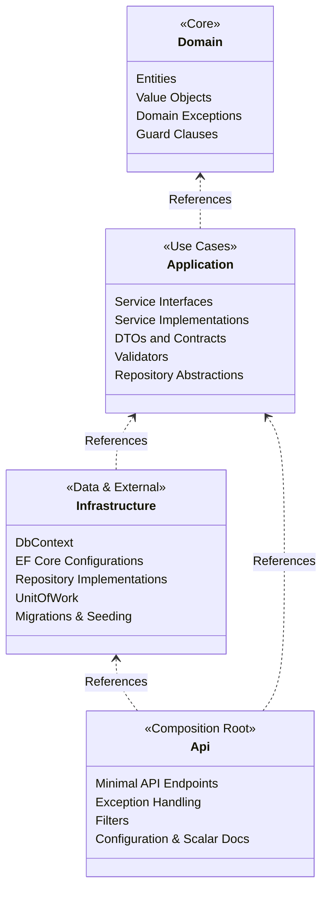
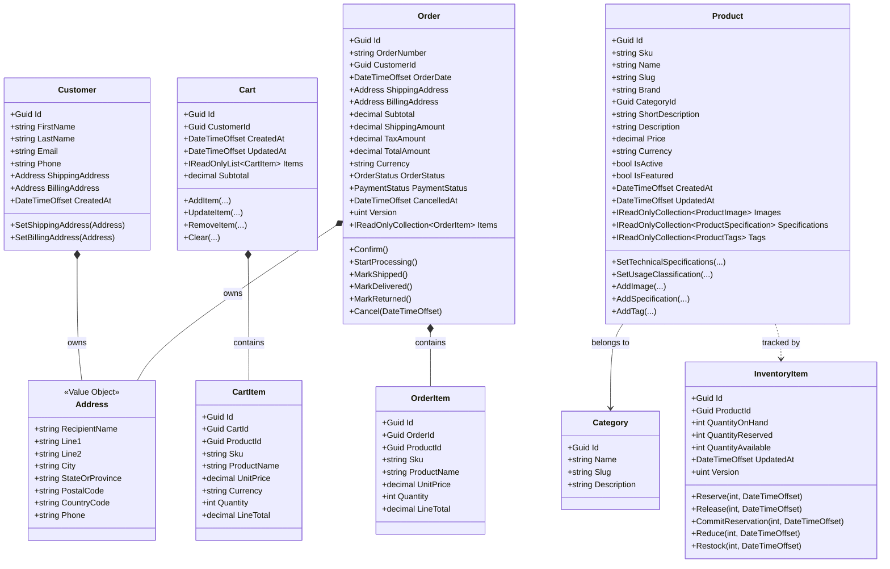
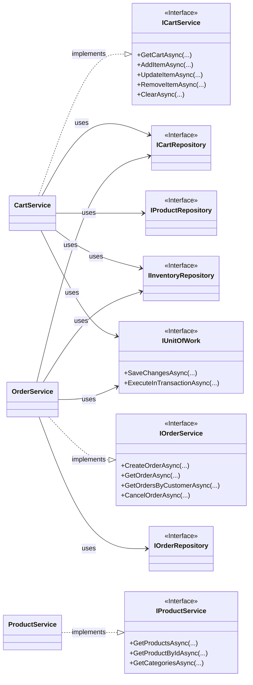

# Class Diagrams & Architecture

---

## 1. Clean Architecture Dependencies

Dependencies point strictly inward toward Domain:

---

## 2. Domain Model Class Diagram

Aggregates, entities, and value objects within `BullMarket.Domain`:

---

## 3. Application Services & Persistence Abstractions

